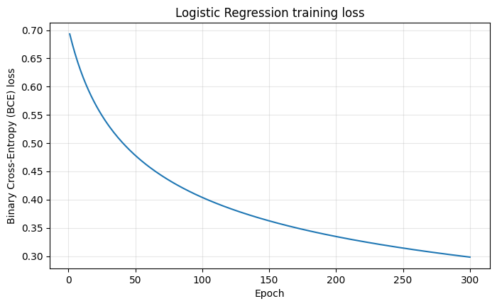

# Sentiment Analysis of IMDB Reviews from Scratch

Three ways to classify movie reviews as positive or negative, built from the ground up in **Python and NumPy**, with no scikit-learn, PyTorch or other machine-learning libraries:

1. **Class-conditional bigram language models**: classify by perplexity, and generate text.
2. **Multinomial Naive Bayes** on unigram and bigram features.
3. **NB-weighted logistic regression**: Naive Bayes log-count ratios as feature weights, then logistic regression trained with gradient descent.

## Results

Test set: 1,000 reviews (500 positive, 500 negative) from the official IMDB test split.

| Model | Accuracy | F1 | Precision | Recall |
|---|---|---|---|---|
| Bigram language model | 84.70% | 0.8428 | 0.8668 | 0.8200 |
| Naive Bayes | 80.30% | 0.7967 | 0.8230 | 0.7720 |
| **NB-weighted logistic regression** | **85.90%** | **0.8627** | 0.8406 | **0.8860** |

- **Logistic regression is best:** +5.6 points of accuracy over Naive Bayes and +1.2 over the bigram LMs. On 1,000 test reviews, one point is just 10 reviews, so the gap over the LMs is small.
- **Naive Bayes is held back by its features, not overfitting:** training accuracy is 81.3%, close to test. Its 2,000 features cover a small slice of the 482,780 distinct n-grams in the training set, and overlapping features ("waste", "waste of") are double-counted.
- **Learning the weights fixes much of that:** logistic regression keeps the Naive Bayes ratios as feature weights but learns how much to trust each one.

## How it works

### Data and pre-processing

A balanced subset of the [Stanford Large Movie Review Dataset](https://ai.stanford.edu/~amaas/data/sentiment/) (Maas et al., 2011): 5,000 training reviews from the official training split and 1,000 test reviews from the official test split, so no review appears in both. Sampling uses fixed seeds, so the subset is the same on every run.

Every cleaning step is based on counting the noise in the data first: HTML line breaks, URLs, letters stretched out for emphasis ("sooooo"), repeated `!`/`?`, and quote marks versus apostrophes. Negations such as *didn't* are kept as single tokens, and `!` and `?` are kept as tokens because they carry sentiment.

### 1. Bigram language models

One bigram LM per class, estimated by counting, with Add-1 smoothing and a shared vocabulary of 41,300 entries so that the two models' probabilities are comparable. A review is classified by which model gives it **lower perplexity**. With balanced classes, this is exactly Bayes' rule.

The same models can also **generate text**, with greedy decoding or top-*k* sampling. Starting from "the movie was", the positive model drifts towards *"a great film"* and the negative one towards *"a movie is a movie"*, a simple illustration that the two models learned different language.

### 2. Naive Bayes

Each review becomes a count vector over the 2,000 most frequent unigrams and bigrams. Add-1 smoothed class-conditional probabilities give a **log-count ratio** r<sub>j</sub> per feature, and the classifier is the linear score log-prior + Σ x<sub>j</sub> r<sub>j</sub>. The ratios are easy to read: the most negative features are *waste of*, *waste* and *the worst*; the most positive include *incredible*, *superb* and *a wonderful*.

### 3. NB-weighted logistic regression

Feature counts are multiplied by r, standardized with training-set statistics, and given a bias column. Logistic regression is then trained with batch gradient descent on binary cross-entropy (computed stably with `logaddexp`).

The learning rate and number of epochs are chosen by **F1 on a held-out validation set** of 500 training reviews. The Naive Bayes ratios and the standardization are re-fitted on the training fold only, so validation labels never leak into the features. The chosen settings (learning rate 0.01, 300 epochs) are then used to retrain on all 5,000 reviews, and the model is evaluated once on the test set.



## Repository structure

```
.
├── imdb_sentiment_from_scratch.ipynb   # the full study: code, outputs and discussion
├── assets/
│   └── lr_loss.png                     # logistic regression loss curve (used in this README)
├── requirements.txt
├── .gitignore
└── README.md
```

## Running it

```bash
git clone https://github.com/sh-toqa/imdb-sentiment-from-scratch
cd imdb-sentiment-from-scratch
pip install -r requirements.txt
jupyter notebook imdb_sentiment_from_scratch.ipynb
```

Run the notebook from top to bottom. The first code cell downloads and extracts the dataset (about 80 MB) into `aclImdb/` if it isn't already there; the dataset is git-ignored.

## Limitations and next steps

- Only 5,000 of the 25,000 training reviews are used, to keep training fast in pure NumPy.
- The 2,000-feature vocabulary is chosen before the validation split, so validation reviews influence which features exist (though not their weights).
- Add-1 smoothing is crude for a 41,300-word vocabulary; Kneser–Ney smoothing would give the language models more realistic probabilities.
- The hyperparameter search covers 4 learning rates × 4 epoch counts.

## Acknowledgements

Built as a team project for a natural language processing course at the Faculty of Engineering, Alexandria University.

Dataset: Andrew L. Maas, Raymond E. Daly, Peter T. Pham, Dan Huang, Andrew Y. Ng and Christopher Potts. *Learning Word Vectors for Sentiment Analysis.* ACL 2011.
